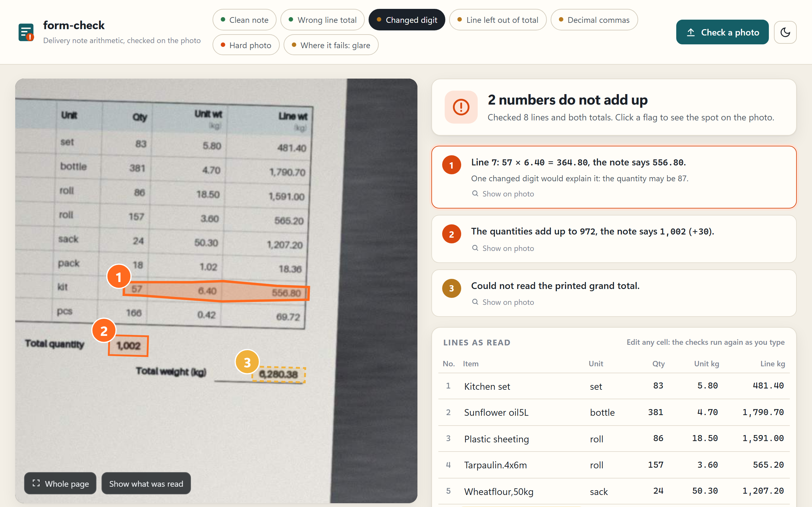
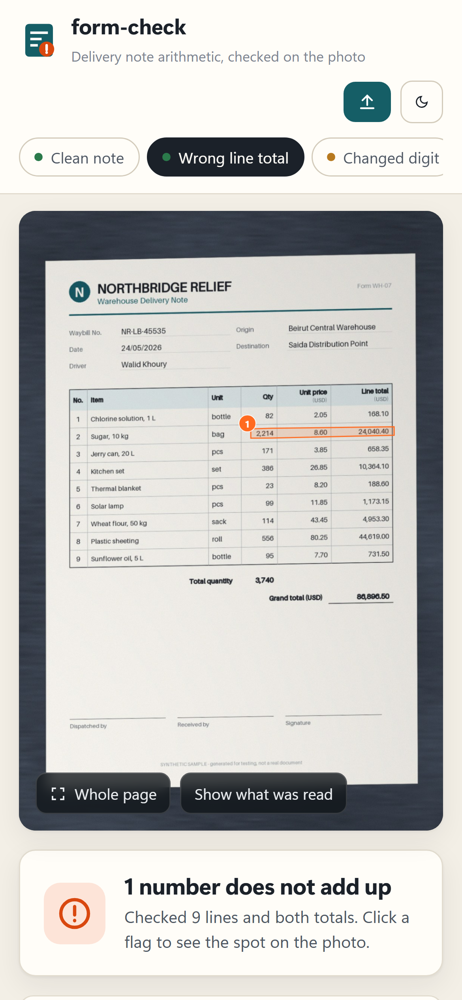
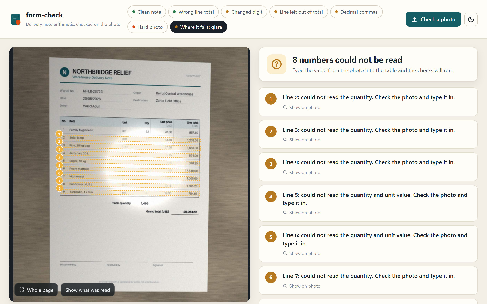

# form-check

Reads a photographed delivery note, checks the arithmetic, and shows the reviewer exactly where on the photo a number does not add up.



## The need

Warehouse and field staff retype figures from paper delivery notes into spreadsheets. One wrong digit, on the paper or in the typing, is hard to catch later, when stock does not reconcile. This tool does not replace the person doing the check. It reads the photo, multiplies and adds every line, and points the reviewer's eyes at the spot that needs them, with a plain sentence such as "Line 7: 57 x 6.40 = 364.80, the note says 556.80."

## Try it

```
python -m venv .venv
.venv/Scripts/activate          # source .venv/bin/activate on Linux or macOS
pip install -e .
formcheck serve                 # open http://127.0.0.1:8103 and pick a sample
```

Or from the command line (real output, saved in [docs/sample-output.txt](docs/sample-output.txt)):

```
$ formcheck check src/formcheck/samples/line-total-easy.jpg
Waybill      NR-LB-45535    Date 24/05/2026
Route        BeirutCentral Warehouse -> SaidaDistributionPoint
Driver       WalidKhoury
Numbers      1,234.50 style

 No  Item                        Unit         Qty    Unit price    Line total
-----------------------------------------------------------------------------
  1  Chlorinesolution,1L         bottle        82          2.05        168.10
  2  Sugar,10kg                  bag        2,214          8.60     24,040.40
  ...
                            Total quantity  3,740
                                                      Grand total   86,896.50

1 flag:
  [1] Line 2: 2,214 × 8.60 = 19,040.40, the note says 24,040.40.
exit code: 1
```

The exit code is 0 when every check passes and 1 when a check fails or a number could not be read, so it can sit in a script.

Everything runs on the machine: OCR is [RapidOCR](https://github.com/RapidAI/RapidOCR) (PaddleOCR models in ONNX, CPU only, installed by pip). No API key, no cloud service, no Tesseract.

The review screen works at phone width:



## How it works

| Step | What it does | Code |
|---|---|---|
| Find the sheet | Builds four candidate outlines (bright paper, colourless paper, strongest edge, loose brightness), keeps the one whose sides sit on the sharpest image edges, and flattens the sheet with a perspective warp. | `ocr.py` |
| Read | RapidOCR returns text boxes with a confidence each. Boxes are kept in flat-page coordinates plus the homography back to the photo. | `ocr.py` |
| Rebuild the table | Measures leftover skew, chains boxes into lines left to right (so a line can drift), finds the heading line, and places each box in a column. Number columns are also found from the data: right-aligned numbers stack into three clusters, which still works when the OCR garbles a heading. Boxes merged across two columns are split. | `table.py` |
| Parse numbers | Decides per page whether the note writes `1,234.50` or `1.234,50` from the numbers that are not ambiguous, then reads every number that way. Puts back a lost decimal mark in money and weight columns and tints that cell as unsure. | `numbers.py` |
| Check | quantity x unit value = line total for each line, the quantity column against the printed total quantity, the line totals against the grand total. A number that cannot be read is a flag of its own, never a pass. | `checks.py` |
| Explain | Each flag carries the outline of its cells on the original photo and a sentence. If one changed digit would make a line add up, it says which, and if a total is short by exactly one line, it says which line. | `checks.py` |

The review screen (`server.py`, one self-contained page, no build step, no CDN) shows the photo with each flag outlined and numbered. Clicking a flag zooms to it. The table beside it is editable, low-confidence cells are tinted, and every edit re-runs the checks.

The test data is synthetic: `generator.py` renders Northbridge Relief delivery notes (a fictional NGO) with Pillow, plants an error in a known share of them (a wrong line total, a grand total that leaves a line out or is miscopied, one changed digit), then "photographs" them: perspective, rotation, uneven light, shadow, blur, sensor noise and JPEG at three difficulty levels. Every note has ground-truth JSON and is reproducible from its seed.

## Results

`formcheck bench --per-level 25` generates 75 notes (25 per level, 40% with a planted error), runs the full pipeline from photo to flags, and compares with the ground truth. This is what it printed ([docs/benchmark.txt](docs/benchmark.txt), details per note in [docs/benchmark.json](docs/benchmark.json)):

```
== easy (25 forms, 12.31 s/form) ==
  header          124/125   99.2%
  text cells      313/328   95.4%
  number cells    489/492   99.4%
  totals           50/50   100.0%
  rows found       25/25   100.0%
  all fields      98.1%
  planted errors 10: caught by a check at the right spot 10, marked unreadable at that spot 0, only other flags 0, nothing flagged 0
  clean notes 15: any flag raised on 0 (arithmetic error flag on 0)
  numbers misread 3, of which slipped through every check 0
== medium (25 forms, 4.35 s/form) ==
  header          108/125   86.4%
  text cells      246/328   75.0%
  number cells    491/492   99.8%
  totals           45/50    90.0%
  rows found       25/25   100.0%
  all fields      89.4%
  planted errors 10: caught by a check at the right spot 10, marked unreadable at that spot 0, only other flags 0, nothing flagged 0
  clean notes 15: any flag raised on 3 (arithmetic error flag on 3)
  numbers misread 6, of which slipped through every check 0
== hard (25 forms, 4.73 s/form) ==
  header           34/125   27.2%
  text cells       33/304   10.9%
  number cells    393/456   86.2%
  totals           23/50    46.0%
  rows found       25/25   100.0%
  all fields      51.7%
  planted errors 10: caught by a check at the right spot 8, marked unreadable at that spot 2, only other flags 0, nothing flagged 0
  clean notes 15: any flag raised on 15 (arithmetic error flag on 15)
  numbers misread 80, of which slipped through every check 3
== overall (75 forms) ==
  planted errors 30: caught 28, unreadable there 2, only other flags 0, nothing flagged 0
  clean notes 45: any flag 18, arithmetic error flag 18
  misread numbers that passed every check: 3 of 89 misreads
```

How to read it:

- "number cells" are quantity, unit value and line total, compared as numbers. "text cells" are item and unit names, compared ignoring case and spaces, because the OCR model often drops spaces. These names are not protected by any check.
- "caught by a check at the right spot" means a flag on the very line (or total) that carries the planted error.
- "slipped through every check" is the honest number: a number the OCR read wrongly with no flag on its line or total, so nothing sends the reviewer there.
- On clean notes, every flag comes from an OCR misread. The flag is right that the extracted number does not add up, but the paper is fine; the reviewer sees that on the zoomed photo and moves on.

The tests (`pytest`) replay recorded OCR output for five photos, so table rebuilding and checks are tested in about a second without the model, including a page turned by up to 5 degrees, lines that drift across the page, a box merged across two columns, a lost decimal mark, a missing column heading and no heading at all. One end-to-end test runs the real OCR model on a generated photo.

## Where it fails

**A misread total when its column has an unreadable line.** This came out of the benchmark (`hard-7003`, a hard photo). The OCR could not read the line total of line 1, so the tool flagged line 1 as unreadable and, correctly, did not check the grand total: a sum with a missing term proves nothing. But the grand total itself was also misread, 15,500.10 for the printed 15,599.16, and no flag points at it. If the reviewer types in line 1 from the photo, the check runs and flags the total; if they only fix line 1 in their spreadsheet and copy the total from the screen, the wrong total goes through. All 3 numbers that slipped through in the benchmark are this case: a total whose check was skipped because one line in its column could not be read. The next fix is to mark a skipped total as "not checked" on the screen instead of leaving it plain.

On hard photos (low resolution, heavy blur, JPEG at quality 50) the tool also stops saving work: only 27% of header fields and 86% of numbers are read right, and every clean note gets at least one flag, so the reviewer checks almost every line by eye anyway.

**Glare.** A flash reflection that washes out part of the table defeats it. On the sample `glare-fails.jpg` the quantity column under the glare cannot be read, so the tool cannot check eight of nine lines, including line 4, which carries a planted error. It says so ("Line 4: could not read the quantity") instead of passing the lines, but the reviewer has to type the values in by hand: the tool has saved no work on that photo.



Other limits, from building it:

- Handwritten figures were not tested. The OCR model is trained on print; a filled-in paper form would need a handwriting model.
- Only this one layout (Form WH-07) was tested. The column logic is general (headings plus number positions), but header fields are found by their printed labels.
- Errors that keep the arithmetic consistent cannot be caught by arithmetic: a quantity miscounted at the warehouse and multiplied correctly is a correct-looking note.

## What I would add next

- A second check source: compare the note with the dispatch record it should match (waybill number, items, quantities), which catches consistent-but-wrong notes.
- An LLM pass could read item names into a standard catalogue and explain flags in Arabic or French for field teams. Not built here: no API key was used, and the arithmetic does not need one.

## Licence

MIT, see [LICENSE](LICENSE). All delivery notes, names and figures in this repository are synthetic.
