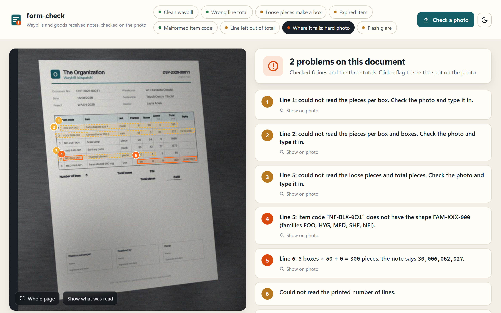

# form-check

Reads a photographed waybill or goods received note, checks it, and shows the warehouse reviewer exactly where on the photo a figure is wrong.


## The need

A humanitarian organization in Lebanon runs about forty warehouses. Stock leaves on a paper waybill to one of its centres or a partner, and comes in on a goods received note from a supplier or a donor. Quantities are counted in pieces but written as boxes plus loose pieces ("12 boxes + 6 pieces" of a 24-piece box), and a keeper later retypes every line into the stock system, often on a phone. One wrong figure, one loose count that should have been a box, or one expired item that slipped onto a waybill is hard to find later. This tool does not replace the keeper's check. It reads the photo, works through every line, and points their eyes at the spot that needs them.

## Try it

```
python -m venv .venv
.venv/Scripts/activate          # source .venv/bin/activate on Linux or macOS
pip install -e .
formcheck serve                 # open http://127.0.0.1:8103 and pick a sample
```

Or from the command line (real output, saved in [docs/sample-output.txt](docs/sample-output.txt)):

```
$ formcheck check src/formcheck/samples/wrong-total.jpg
Waybill (dispatch)    DSP-2026-01424    Date 13/01/2026
Warehouse             WH-22JbeilHills    Project EA-2026
Destination           Jbeil Centre/Medical
Keeper                Fadi Mansour

 No  Item code     Item                    Per box   Boxes   Loose    Total      Expiry
---------------------------------------------------------------------------------------
  ?  FOO-CHE-004   Canned cheese200g            24      26       0      624  24/10/2027
  2  HYG-PAD-001   Sanitary pads                36      10       0      360           -
  3  SHE-TAR-001   Tarpaulin4x6m                 5      22       1      111           -
  4  FOO-MLK-001   Milkpowder400g               12      45      10      505  29/12/2026
  5  MED-ORS-002   Oralrehydrationsalts        100      32       0    3.200  21/08/2026

Number of lines 5    Total boxes 135    Total pieces 4.800

1 flag:
  [1] Line 4: 45 boxes × 12 + 10 = 550 pieces, the note says 505.
      Possible reading: the total may be 550 with two digits swapped.
exit code: 1
```

The exit code is 0 when every check passes and 1 when a check fails or a figure could not be read, so it can sit in a script. Everything runs on the machine: the OCR is [RapidOCR](https://github.com/RapidAI/RapidOCR) (PaddleOCR models in ONNX, CPU only, installed by pip). No API key, no cloud service.

The review screen works at phone width, where most keepers would use it:


## How it works

| Step | What it does | Code |
|---|---|---|
| Find the sheet | Builds four candidate outlines (bright paper, colourless paper, strongest edge, loose brightness), keeps the one whose sides sit on the sharpest image edges, and flattens the sheet with a perspective warp. | `ocr.py` |
| Read | RapidOCR returns text boxes with a confidence each, kept in flat-page coordinates plus the mapping back to the photo. | `ocr.py` |
| Rebuild the table | Measures leftover skew, chains boxes into lines left to right, finds the heading line, and places each box in a column. Count columns are also found from the numbers (they are right-aligned and stack into four clusters), item codes and dates are recognised by their shape, and boxes merged across columns are split. A lone "0" the OCR missed in the loose column is filled in only when the line already adds up without it, and tinted as unsure. | `table.py` |
| Check | boxes × pieces per box + loose = total pieces; loose pieces fewer than a box; expiry not already past on the document date; item code shaped like `FOO-RIC-001` (families FOO, HYG, MED, SHE, NFI, read letter-or-digit by position); number of lines, total boxes and total pieces equal the lines. A figure that cannot be read is a flag of its own, never a pass. | `checks.py` |
| Explain | Each flag carries its outline on the original photo and a sentence such as "Line 4: 45 boxes × 12 + 10 = 550 pieces, the note says 505." When one changed or swapped digit explains a line, or a total is short by exactly one line, it says so. | `checks.py` |

The review screen (`server.py`, one self-contained page, no build step, no CDN) shows the photo with each flag outlined and numbered. Clicking a flag zooms to it; the table beside it is editable, low-confidence cells are tinted, and every edit re-runs the checks.

The test data is synthetic. `generator.py` draws waybills (`DSP-2026-…`) and goods received notes (`RCV-2026-…`) for the unnamed Organization: warehouse codes `WH-01` to `WH-40`, invented project codes (`FA-2026`, `EA-2026`, `WASH-2026`, `INKIND`), invented centres, partners, suppliers, donors and keepers, items with pieces-per-box figures and expiry dates where the item tracks expiry. Half the documents carry one planted error of eight kinds: a wrong line total, one changed digit, a total pieces or total boxes that disagrees with the lines, a wrong line count, loose pieces that make a full box, an expired item, a malformed item code. Each page is then "photographed" (perspective, rotation, uneven light, shadow, blur, noise, JPEG) at three difficulty levels, with ground-truth JSON, reproducible from its seed.

## Results

`formcheck bench --per-level 25` generates 75 documents (25 per level, half with a planted error), runs the whole pipeline from photo to flags, and compares with the ground truth. This is what it printed ([docs/benchmark.txt](docs/benchmark.txt), details per document in [docs/benchmark.json](docs/benchmark.json)):

```
== easy (25 documents, 16.2 s each) ==
  header                148/150   98.7%
  item codes, raw OCR   173/173  100.0%
  item codes, cleaned   173/173  100.0%
  text cells            313/346   90.5%
  count cells           689/692   99.6%
  expiry dates          107/107  100.0%
  totals                 72/75    96.0%
  rows found             25/25   100.0%
  all fields            97.3%
  planted errors 13: caught by a check at the right spot 13, marked unreadable there 0, only other flags 0, nothing flagged 0
  clean documents 12: any flag on 3 (error flag on 1)
  counts misread 2, of which slipped through every check 0; item codes misread into another valid code 0
== medium (25 documents, 9.75 s each) ==
  header                120/150   80.0%
  item codes, raw OCR   145/168   86.3%
  item codes, cleaned   153/168   91.1%
  text cells            236/336   70.2%
  count cells           654/672   97.3%
  expiry dates           92/99    92.9%
  totals                 59/75    78.7%
  rows found             25/25   100.0%
  all fields            87.6%
  planted errors 13: caught by a check at the right spot 12, marked unreadable there 0, only other flags 1, nothing flagged 0
  clean documents 12: any flag on 11 (error flag on 9)
  counts misread 11, of which slipped through every check 0; item codes misread into another valid code 0
== hard (25 documents, 9.43 s each) ==
  header                 18/150   12.0%
  item codes, raw OCR    14/142    9.9%
  item codes, cleaned    20/142   14.1%
  text cells             17/284    6.0%
  count cells           404/568   71.1%
  expiry dates           21/80    26.2%
  totals                 32/75    42.7%
  rows found             21/25    84.0%
  all fields            39.4%
  planted errors 13: caught by a check at the right spot 4, marked unreadable there 6, only other flags 3, nothing flagged 0
  clean documents 12: any flag on 12 (error flag on 11)
  counts misread 57, of which slipped through every check 2; item codes misread into another valid code 7
== overall (75 documents) ==
  planted errors 39: caught 29, unreadable there 6, only other flags 4, nothing flagged 0
  clean documents 36: any flag 26, error flag 21
  counts misread that passed every check: 2 of 70; item codes misread into another valid code: 7
```

Next to the previous version of this project (priced delivery notes with quantity × unit price, 75 documents, 40% with a planted error, measured the same way):

| | Before | Now |
|---|---|---|
| All fields read right: easy / medium / hard | 98.1% / 89.4% / 51.7% | 97.3% / 87.6% / 39.4% |
| Planted errors caught at the right spot | 28 of 30 (2 more marked unreadable there) | 29 of 39 (6 more marked unreadable there, 4 flagged only elsewhere) |
| Planted errors with nothing flagged | 0 | 0 |
| Clean documents with any flag | 18 of 45 | 26 of 36 |
| Misread numbers that passed every check | 3 of 89 | 2 of 70, plus 7 item codes misread into another valid-looking code |

The new documents are harder for the OCR: nine narrow columns in smaller print instead of six, single-digit counts (the detector often skips a lone digit), and item codes. Item codes were read right 100% of the time on easy photos, 86% raw and 91% after the position-aware clean-up on medium photos, and 10% raw, 14% cleaned on hard ones.

How to read it: "count cells" are pieces per box, boxes, loose and total, compared as numbers; "text cells" are item names and units, compared ignoring case and spaces (the OCR model often drops spaces) and protected by no check. "Slipped through" means a figure read wrongly with no flag on its line or total. On clean documents every flag comes from an OCR misread or an unread cell: the flag is right that the extracted figure does not check out, the paper is fine, and the reviewer sees that on the zoomed photo.

How the rules were tuned: the table and check rules were adjusted on six recorded fixture documents and the sample photos (seeds below 1000), never on the benchmark documents (seeds 5000 and up). The benchmark OCR ran once; its scores were then recomputed once from the saved OCR output after two fixes found on the fixtures (a unit "box" taken for the "Boxes" heading, and codes and dates routed by their shape).

The tests (`pytest`) replay recorded OCR output for six documents, so table rebuilding and checks run in a few seconds without the model, including a page turned by up to 5 degrees, lines that drift across the page, a box merged across two columns, a missed zero, and no heading line at all. One end-to-end test runs the real OCR model on a generated photo.

## Where it fails

**An item code misread into another valid code.** On the hard photo `hard-7001` the OCR read `SHE-MAT-002` (foam mattress) as `SHE-MAT-007`. That has the right shape, so the code check passes, and nothing points the reviewer at it. Seven codes in the benchmark slipped through this way, all on hard photos. A shape check cannot catch it; checking the code against the item catalogue and the item name next to it would.

**Hard photos.** On low-resolution, blurred, heavily compressed photos (the hard level) only 39% of fields are read right and every clean document gets a flag, so the keeper checks almost every line by eye anyway. The sample "Where it fails: hard photo" shows it: lines with unread counts, a malformed code that is really a misread, and a total merged with the expiry date next to it.



Other limits:

- Handwritten figures were not tested. The OCR model is trained on print; filled-in paper forms would need a handwriting model.
- Only this one layout was tested. The column logic is general (headings, number positions, the shape of codes and dates), but header fields are found by their printed labels.
- Errors that keep every figure consistent cannot be caught on paper alone: 300 pieces dispatched when 250 left the shelf is a correct-looking waybill. That needs the stock ledger.

## What I would add next

- Check each line against the stock system: the item code exists and matches the name, the project holds that stock in that warehouse, and the dispatch would not drive the balance negative.
- Arabic and French labels and messages for keepers who work in those languages.
- An LLM pass could map messy item names to catalogue codes. Not built here: no API key was used, and the checks do not need one.

## Licence

MIT, see [LICENSE](LICENSE). All documents, codes, names and figures in this repository are synthetic.
